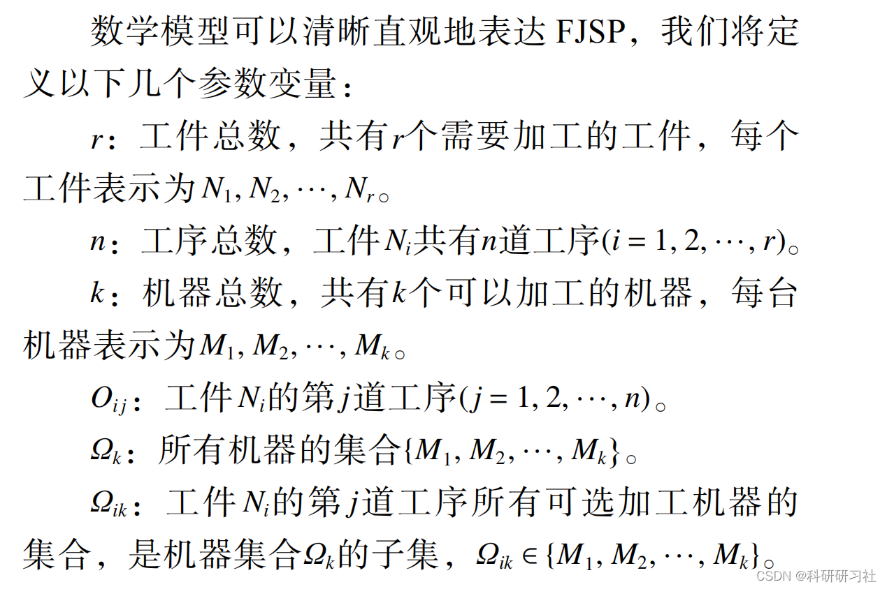
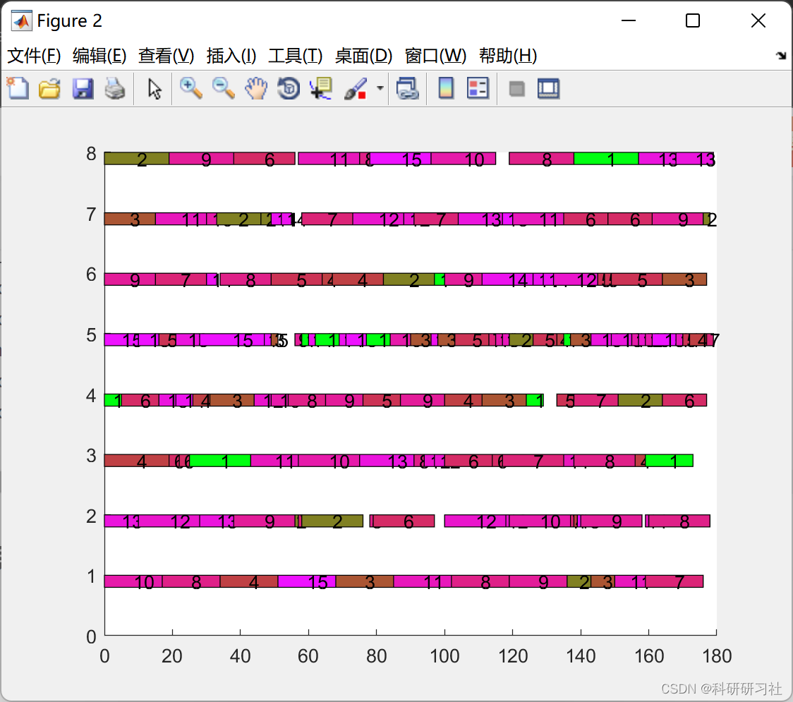
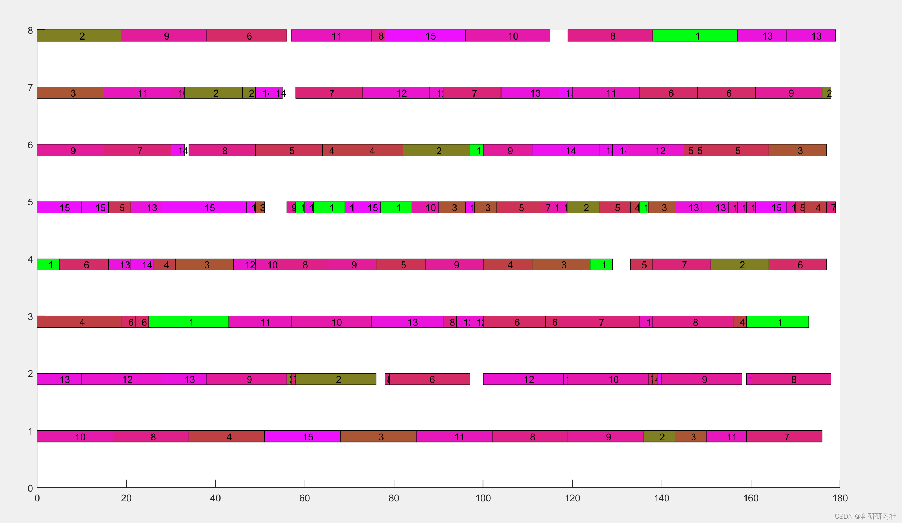
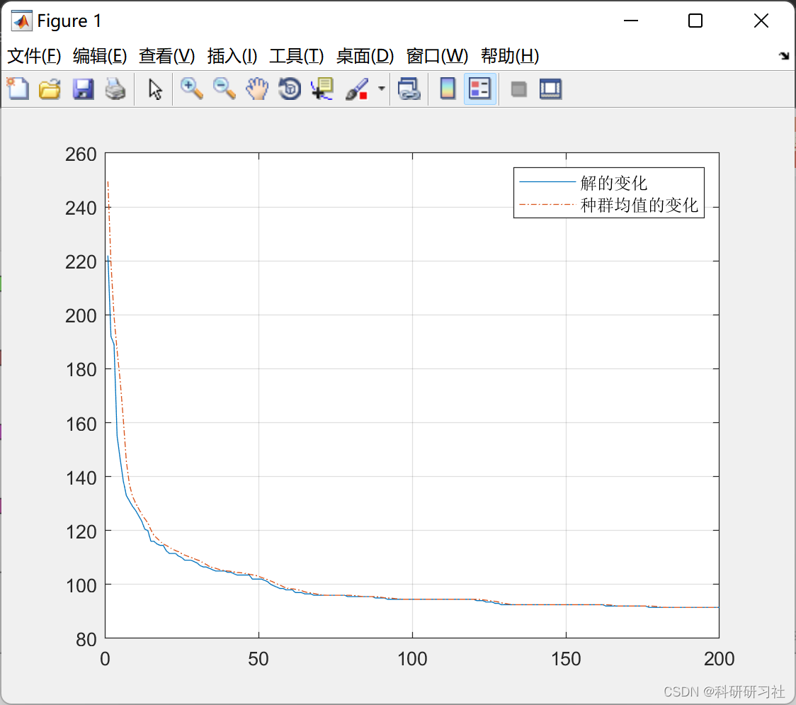

# Workshop Scheduling | Workshop Scheduling Based on the Emerald Butterfly Optimization Algorithm (Matlab Code Implementation)

1. Overview
As intelligent manufacturing becomes more prevalent, solving the issue of production scheduling in workshops can effectively enhance work and learning efficiency within the workshop, achieving orderly, intelligent, and efficient management on-site. To rationally coordinate and control the production of various machines to achieve a Pareto optimal state across multiple objectives, scholars have conducted years of research using various methods to analyze and solve the FJSP in production processes.
With the deepening of research, to better align with the working conditions of the workshop production, the concept of flexible workshops has been integrated with the workshop scheduling problem, leading to the introduction of FJSP. Since FJSP is widely present in production, it has attracted widespread attention and research from domestic and international scholars. Ishibuchi H used genetic algorithms to solve the FJSP problem, but the effectiveness of the algorithm was relatively low. Deng Q W used NSGA-II algorithm and considered two stages to solve multi-objective FJSP, and verified the accuracy of the algorithm through some commonly used functions. Kaya S introduced a new method based on the idea of MILP to solve the FJSP problem where the goal is to minimize the completion time while maximizing the load on the bottleneck operation and minimizing the load on the machine and the bottleneck operation.
2. Butterfly Optimization Algorithm - Based on the MBO (Matlab complete code implementation)
3. Workshop Scheduling
3.1 Workshop Scheduling
Workshop scheduling is based on the limited available resources and pre-determined production plans in an actual workshop, arranging production routes reasonably under the premise of meeting process constraints to balance production loads, completing production plans while achieving certain established goals. FJSP is proposed to address how to combine job shop scheduling with multiple parallel machines, involving two main issues:
(1) How to process jobs in sequence.
(2) How to reasonably allocate machines.
The FJSP problem has been proven to be a more complex NP-hard problem. The FJSP problem in this paper is mainly based on solving the above two problems, combined with the actual production of the workshop to achieve the goal of minimizing the completion time and total process time. The Pareto optimal solution is sought out by combining these objectives.

The FJSP can be described using the following example: Assume there are m machines in the workshop, which need to process n jobs. Each machine is represented as M, and each job is represented as N1, N2,..., Nn. Each job's processing process on a machine is called a process, denoted as the jth process of job i. The ultimate goal is to minimize the time taken to complete the batch of jobs and the energy consumed. Relevant constraints include:
(1) A machine can only process one job at a time at any given moment.
(2) The processes for each job are the same, and the order of processes is the same. Depending on the case, the time required for different jobs to be processed on different machines varies.
(3) Same job cannot be processed by different two machines at the same moment.
(4) Jobs cannot switch machines during processing. A classic FJSP is shown below. For example, with 5 machines processing 3 jobs, each job having 3 processing processes, the schedule is shown in Table 1.

Mathematical Model

Matlab Code Implementation
This paper only showcases part of the code, all codes can be found in:
Workshop Scheduling | Workshop Scheduling Based on Emerald Butterfly Optimization Algorithm (Matlab Code Implementation)
clc;clear\n%% Download data\n% The processed data includes processing time, processing machine, machine number, machine weight, workpiece number, and the number of processes corresponding to each workpiece.\nload data operation_time operation_machine num_machine machine_weight num_job num_op\n\n%% Basic Parameters\nMAXGEN=200;             % Max number of iterations\nsizepop=201;            % Population size\ne=0.5;                  % Target Weight\nN_size=30;              % Number of neighborhood solutions\nS_size=15;              % Number of shared decompositions\nG=5;                    % Number of tours\nG1=20;                  % Competition Mechanism 1 parameters\nG2=10;                  % Competition Mechanism 2 parameters\ntrace=zeros(2,MAXGEN);\nchrom_best=[];\n\n%% ============================ Initialization of Population ==========================\ntotal_op_num=sum(num_op);\nchroms=initialization(num_op,num_job,total_op_num,sizepop,operation_machine,operation_time);\n[Z,~,~,~,~]=fitness(chroms,num_machine,e,num_job,num_op);\n% Divide the best solution into leading birds\n[Z_leader,ind]=min(Z);\nleader=chroms(ind,:); \n% Remove the swans from chroms and then split them into two separate swan populations\nchroms(ind,:)=[];\nZ(ind)=[];\nsp=(sizepop-1)/2;\nlefts=chroms(1:sp,:);\nZ_left=Z(1:sp);\nrights=chroms(sp+1:end,:);\nZ_right=Z(sp+1:end);\n\n%% ============================Iterative Process=============================\nfor gen=1:MAXGEN\n    fprintf('Current iteration count: '),disp(gen)\n    %% Circuit phase\n    for i=1:G\n        %% Leaving the bird evolves\n        [leader,Z_leader,share,Z_share]=bird_evolution(leader,Z_leader,[],[],...\n            N_size,S_size,total_op_num,num_machine,e,num_job,num_op);\n        %% Evolution of birds\n        % Initialize the shared solution for left and right queues\n        share_left=share;\n        Z_share_left=Z_share;\n        share_right=share;\n        Z_share_right=Z_share;\n        for j=1:sp\n            % Left queue\n            [lefts(j,:),Z_left(j),share_left,Z_share_left]=bird_evolution(lefts(j,:),Z_left(j),share_left,Z_share_left,...\n                N_size-S_size,S_size,total_op_num,num_machine,e,num_job,num_op);\n            % Right Queue\n            [rights(j,:),Z_right(j),share_right,Z_share_right]=bird_evolution(rights(j,:),Z_right(j),share_right,Z_share_right,...\n                N_size-S_size,S_size,total_op_num,num_machine,e,num_job,num_op);\n        end\n        %% Competition Mechanism 2: Inter-Team Crossover\n        % Randomly generate G2 pairs with identical individuals\n        ind=randperm(sp,G2);\n        [rights(ind,:),Z_right(ind),lefts(ind,:),Z_left(ind)]= crossover(lefts(ind,:),rights(ind,:),...\n            Z_left(ind),Z_right(ind),total_op_num,num_machine,e,num_job,num_op);\n    end\n    %% Competition Mechanism 1: Within-Team Competition\n    ind=randperm(sp,G1);\n    % Left queue\n    [~,ind1]=sort(Z_left(ind));\n    lefts(ind,:)=lefts(ind(ind1),:);\n    Z_left(ind)=Z_left(ind(ind1));\n    % Right Queue\n    [~,ind2]=sort(Z_right(ind));\n    rights(ind,:)=rights(ind(ind2),:);\n    Z_right(ind)=Z_right(ind(ind2));\n    %% Replaced by Leaving Wings\n    if rand<0.5\n        % Select the first bird in the left queue\n        [leader,Z_leader,lefts,Z_left]=update_leader(leader,Z_leader,lefts,Z_left);\n    else\n        % Select the first bird in the right queue\n        [leader,Z_leader,rights,Z_right]=update_leader(leader,Z_leader,rights,Z_right);\n    end\n    %% Record relevant data\n    % Record the optimal fitness and average fitness of each generation\n    Z=[Z_leader,Z_left,Z_right];\n    [val,ind]=min(Z);\n    trace(1,gen)=val;\n    trace(2,gen)=mean(Z);\n    % Update the global optimal fitness\n    if gen==1 || MinVal>trace(1,gen)\n        MinVal=trace(1,gen);\n    end\nend\n\n%% ============================Output Result=============================\n%% Output the optimal fitness\nfprintf('Optimal fitness: '),disp(MinVal)\n%% Plotting the iterative curve of optimal fitness and average fitness.\nfigure(1)\nplot(trace(1,:));\nhold on;\nplot(trace(2,:),'-.');grid;\nlegend('Changes in the solution','Changes in the mean population');\n%% Draw the Gantt chart of the global optimal solution.\n[Z,~,~,machine_time,Pvals]=fitness(leader,num_machine,e,num_job,num_op);\nPval1=Pvals{1,1};\nfigure(2);\nfor i=1:total_op_num\n    mText=leader(total_op_num+i);\n    b=leader(i);\n    x1=Pval1(1,i);\n    x2=Pval1(2,i); \n    y1=mText-0.2;\n    y2=mText;\n    hold on; \n    fill([x1,x2,x2,x1],[y1,y1,y2,y2],[1-1/b,1/b,b/num_job]);\n    text((x1+x2)/2,mText-0.1,num2str(b));\nend\n  
5. Running results editing
Editor
6. References [1] Yang Hongxiong, Wang Huiming. The Sparrow Search Algorithm for Solving the Scheduling Problem in Flexible Job Shops [J]. Manufacturing Technology and Machine Tools, 2022(7):158-164
[2] Zheng Hongqing, Feng Wenjian, Zhou Yongquan. Butterfly Optimization Algorithm with Sinusoidal Coefficients Integration [J]. Guangxi Science, 2021, 28(2): 152-159
​  

## Images

<!-- PAYMENT_BLOCK -->

## Get this dataset

- Payment link (Stripe): [Buy now](https://buy.stripe.com/3cs8yP7sY87d0vu9AB)
- Payment QR code: 

<!-- /PAYMENT_BLOCK -->
